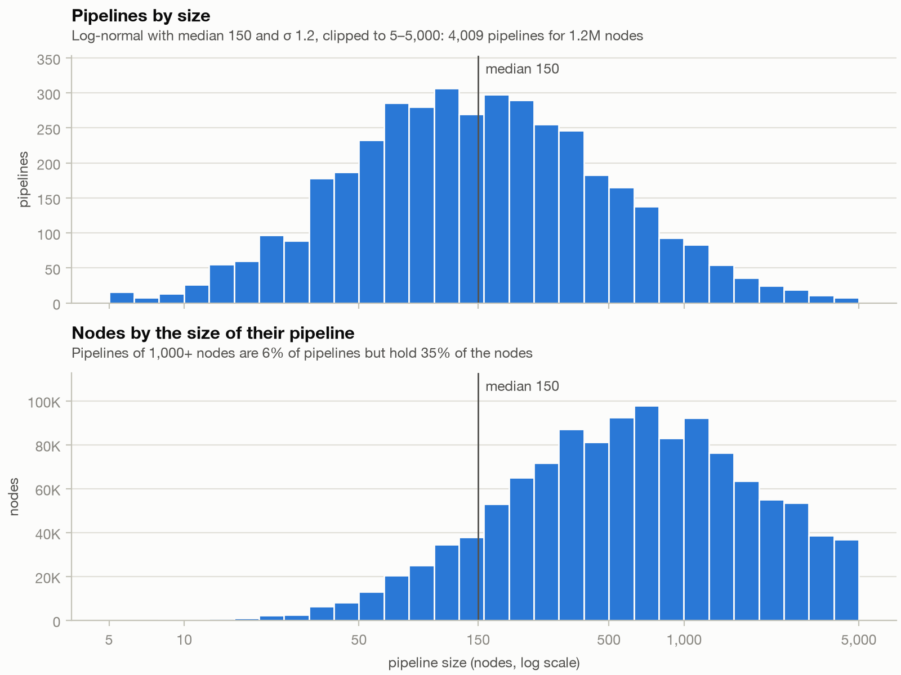
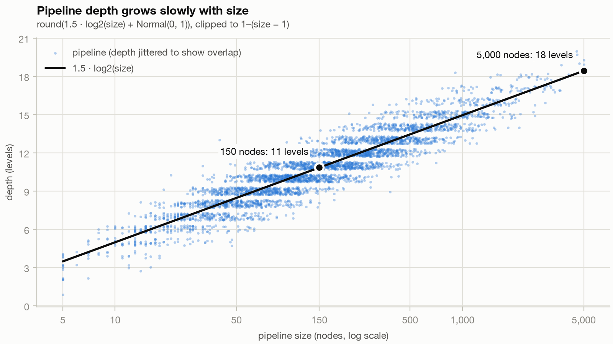
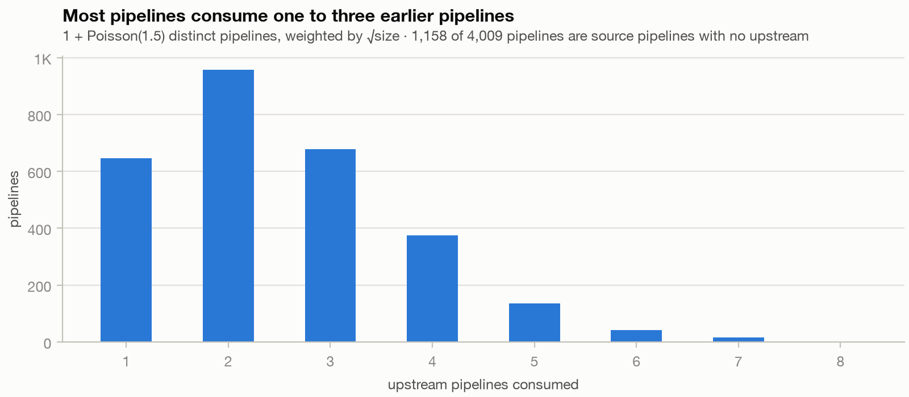
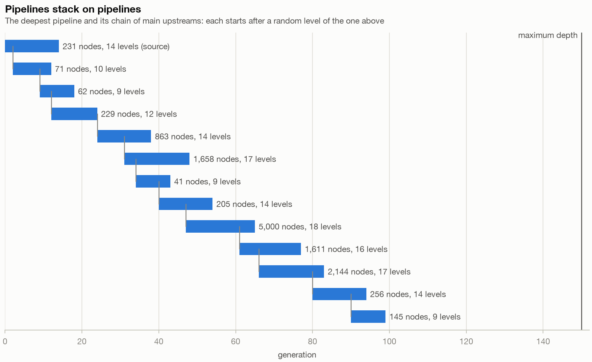
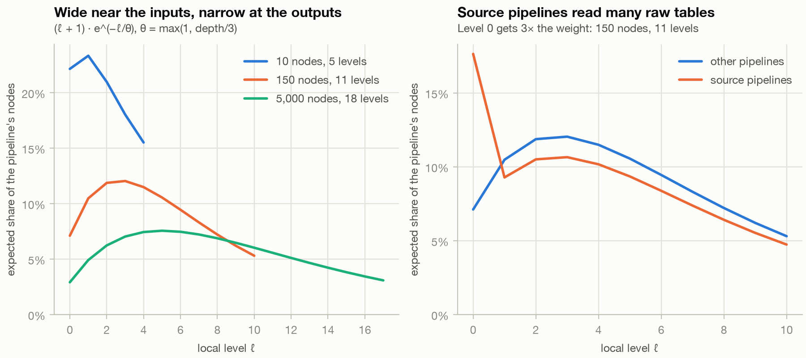
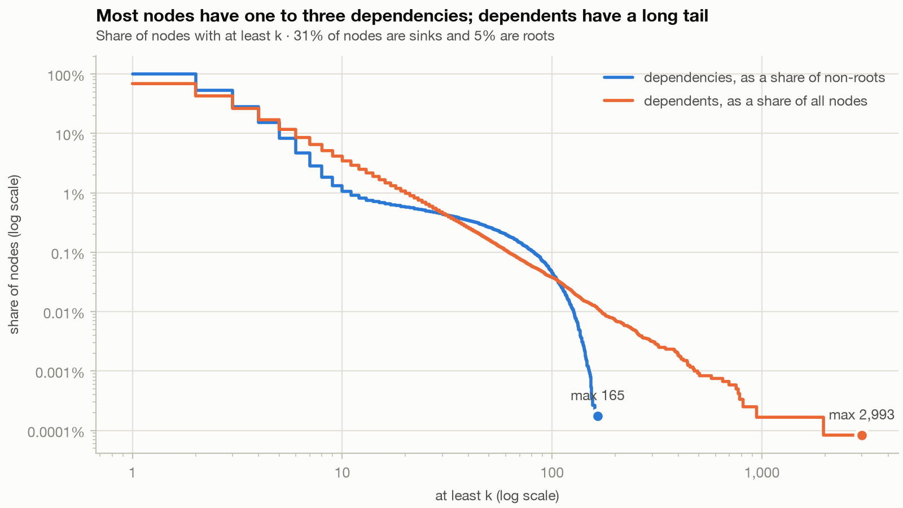

# Performance experiments for dag workflows

Performance experiments following a discussion
on whether to use generational topological searches
to compile an execution plan vs evaluating the dag
representation in runtime, specifically for large
(500k-5M nodes) flows

This split up in a few parts:

1. Generating synthetic graphs that simulate the shapes of actual data pipeline dags
2. Using the synthetic graphs, evaluating the memory and computational complexity of runtime dag evaluation vs compiling
   an execution plan
3. A solution for coordinating runtime dag evaluation in a distributed system of workers, with MongoDB as the
   central data store.

# Generating synthetic graphs representing actual data pipeline dags

The experiments run on synthetic graphs shaped like data-flow dependency graphs (ETL, lineage,
build-style task execution). The generator lives in `src/dag_experiments/synthetic/generator.py`.
Realism matters most for the properties that drive the cost of sorting and evaluating a graph:

- the number of generations and how many nodes each holds: a generational sort produces one
  batch per generation
- how many dependencies and dependents nodes have: completing a node means visiting its dependents
- hubs: nodes many others depend on
- locality: edges mostly stay inside a module
- downstream spread: how much of the graph a failed or rerun node affects

Terms used below:

- **Dependency (parent)**: an input of a node. Edges point from parent to child.
- **Root**: a node with no dependencies. **Sink**: a node with no dependents.
- **Generation**: the length of the longest path from any root. Roots are generation 0.

## Shape: pipelines stacked on pipelines

The graph is made of thousands of pipelines (modules) of different sizes. Each pipeline is
internally layered. Most pipelines consume outputs of earlier pipelines, and a few heavily shared
nodes act as global hubs.

The generator picks every node's generation first, then adds edges under two rules that make the
planned generation the real one:

- every edge goes from a lower to a higher planned generation, so the graph has no cycles;
- every non-root gets exactly one parent one generation lower, its _level-fixing parent_.

Both rules are asserted on every generated graph. The planned generations are part of the output,
as the expected answer when testing a generational sort.

## Parameters and why

All parameters are fields of `GraphParams`; the values below are the baseline.

### Pipelines

- **1,200,000 nodes**, which is also the reference size for the pipeline sizes below. To test
  another size, change only the node count.
- **Pipeline size**: log-normal with median 150 and σ 1.2, clipped to 5–5,000, which gives about
  4,000 pipelines. Real systems have many small pipelines and a few large ones. The cap keeps any
  single module from becoming one large, evenly connected blob, which would make downstream spread
  unrealistically large.
- **Pipeline size at other node counts**: the median and the cap scale with √(nodes / 1.2M), so
  bigger graphs get both more and bigger pipelines. σ is already a relative spread and the 5-node
  minimum stays. At 10k nodes this gives median 14 and cap 456 (362 pipelines); at 5M, median 306
  and cap 10,206 (8,047 pipelines).
- **Pipeline depth** (number of internal levels): round(1.5 × log₂(size) + Normal(0, 1)), clipped
  to 1–(size − 1). Bigger pipelines are deeper, but depth grows slowly with size: 150 nodes gives
  about 11 levels, 5,000 about 18.
- **Source pipelines**: 30% of pipelines start at generation 0 and read raw inputs.
- **Upstreams**: every other pipeline consumes 1 + Poisson(1.5) earlier pipelines, weighted by
  √size because popular pipelines get consumed more. It starts just after a uniformly random level
  of its main (first) upstream, because it consumes the output of some step there. Total graph
  depth comes out of this stacking; it is not set directly.
- **Maximum depth**: 150 generations, only as a trim: pipelines that would go past it are shifted
  earlier or shortened. Graphs of up to 5M nodes stay below it (92–127 generations at 5M over seeds
  0–2). A tight cap (for example 30) piles nodes into the last generations instead of leaving a
  thin tail.



Half of the pipelines have fewer than 150 nodes, but together they hold only 12% of the nodes.







Each pipeline starts right after some level of its main upstream, so depth adds up along a chain
of main upstreams. In the baseline, 13 stacked pipelines reach generation 98.

### Nodes per level

- In a pipeline of depth d, the share of nodes at local level ℓ is proportional to
  (ℓ + 1)·e^(−ℓ/θ) with θ = max(1, d/3), with at least one node per level. Pipelines are wide near
  their inputs and narrow toward their outputs. The one-node minimum provides the level-fixing
  parent for the next level.
- In source pipelines, level 0 gets 3× the weight: many raw tables feed a few transformations.
  These level-0 nodes are roots.
- In other pipelines, about 2% of the nodes sit at generation 0 as extra roots (seed, lookup or
  static data).



In small pipelines the one-node minimum flattens the curve: a 10-node pipeline with 5 levels has
little left to distribute.

### Edges

- **Level-fixing parent**: from the node's own pipeline, or from the main upstream for nodes on
  the pipeline's first level.
- **Number of extra parents**: geometric with mean 1.2, so about 45% of nodes get none. 1% of
  nodes are instead wide joins or unions with 5–200 extra parents (log-uniform).
- **Where each extra parent comes from:**
  - 75% the same pipeline, at generation L − span with span ~ Geometric(p = 0.6): most edges reach
    back one level, some skip further. Reaching below the pipeline's first level, a source pipeline
    uses its level 0; other pipelines use their extra roots half the time, otherwise an upstream.
  - 15% an upstream pipeline: a random upstream, at a uniformly random level below L. Source
    pipelines have no upstreams and use their level 0 instead.
  - 10% a global hub: any node below generation L, weighted by popularity × e^(−generation/2), so
    hubs sit near the bottom of the graph (dimension tables, calendars, config).
- **Popularity**: each node has a fixed score drawn from Pareto(α = 1.3, minimum 1). Within the
  chosen pipeline and level, the parent is picked proportionally to popularity. This creates hubs
  inside pipelines and a long tail in the number of dependents. A lower α concentrates hubs more,
  at the cost of more sinks.
- Duplicate edges are removed.


Three small pipelines from the baseline graph. The source pipeline starts with a wide level of
raw-input roots. The other two sit on top of an upstream pipeline: the gray column just before
their first level is the main upstream's level that feeds it, their extra roots at generation 0
feed later levels, and the gray parents further left are other upstream levels or global hubs.

### Finishing

Node ids are shuffled and edges come in random order, so neither says anything about the
topological order. Otherwise sorts that happen to follow id order look faster than they are.
Generation is deterministic for a given seed.

## Results

Baseline, seed 0. Values vary somewhat with the seed.

| Statistic                           | Baseline                                      |
|-------------------------------------|-----------------------------------------------|
| Edges                               | 2,763,635 (2.30 per node)                     |
| Dependencies per non-root           | mean 2.43, p50 2, p99 10, max 165             |
| Dependents per node                 | p50 1, p99 19, max 2,993                      |
| Roots / sinks                       | 5.3% / 31.0%                                  |
| Generations                         | 99                                            |
| Nodes in generation 0               | 64,197                                        |
| Nodes in the median generation      | 3,194 (3.2k–9.1k over seeds 0–3)              |
| Nodes in the last three generations | 17, 16, 7                                     |
| Edges to the previous generation    | 65%                                           |
| Edges skipping more than 5          | 14%                                           |
| Edges inside a pipeline             | 82%                                           |
| Largest weakly connected part       | 99.4% of nodes                                |
| Downstream spread, random node      | p50 3, p90 1,336, p99 26,084                  |
| Downstream spread, top 5 hubs       | 35%, 35%, 25%, 22%, 25% of the graph          |
| Redundant edges (A→C next to A→B→C) | 10% (10.2% on a 10k-edge sample)              |




Dependencies fall off quickly, apart from a plateau between about 10 and 100 from the 1% of nodes
that are wide joins. Dependents have a long tail from popularity: the top hubs have hundreds to a
few thousand dependents.

### Scaling

Same parameters, only the node count changed, on an Apple M5 Pro with 24 GB:

| Nodes     | Pipelines | Edges      | Edges per node | Generations | Seconds |
|-----------|-----------|------------|----------------|-------------|---------|
| 10,000    | 362       | 19,554     | 1.96           | 47          | 0.0     |
| 100,000   | 1,232     | 211,292    | 2.11           | 70          | 0.1     |
| 1,200,000 | 4,009     | 2,763,635  | 2.30           | 99          | 1.2     |
| 5,000,000 | 8,047     | 11,877,137 | 2.38           | 127         | 5.9     |

Time grows linearly. Smaller graphs have smaller pipelines, which changes their shape a little:

- Level 0 of source pipelines holds a bigger share of the nodes, so roots rise to 8.1% at 10k
  nodes (4.7% at 5M).
- Levels are smaller, so repeated parent picks collapse into one edge more often: 21% of drawn
  edges are duplicates at 10k nodes, 10% at 1.2M.

Together this drops edges per node to 1.96 at 10k nodes. Generations grow with size, because there
are more pipelines to stack and bigger pipelines are deeper. At a given size the seed matters
about as much: 92–127 generations at 5M over seeds 0–2. Peak memory is
about 0.75 GB at 1.2M nodes and 3.0 GB at 5M, mostly temporary arrays while drawing parents; the
finished graph takes 32 MB and 135 MB.

# Evaluating the memory and computational complexity

# a solution for coordinating runtime dag evaluation on distribute

## In a fully local setup

## Deployed as a google cloud run project

# Running the experiments yourself

Install [uv](https://docs.astral.sh/uv/), then from the repository root:

```shell
uv sync
uv run pytest
```

## Synthetic graphs

```shell
# Generate one graph and print the statistics from the results table
uv run python -m dag_experiments.synthetic report
uv run python -m dag_experiments.synthetic report --nodes 5000000 --seed 1

# Generate 10k, 100k, 1.2M and 5M nodes to check scaling
uv run python -m dag_experiments.synthetic sweep
```

Downstream spread and redundant edges are estimated on samples of 1,000 nodes and 2,000 edges.

## Visualizations

```shell
# Redraw the charts in docs/images from the baseline graph
uv run python -m dag_experiments.visualization.charts
```

## Distributed workers

### On a development system: docker

### On a google cloud run project
