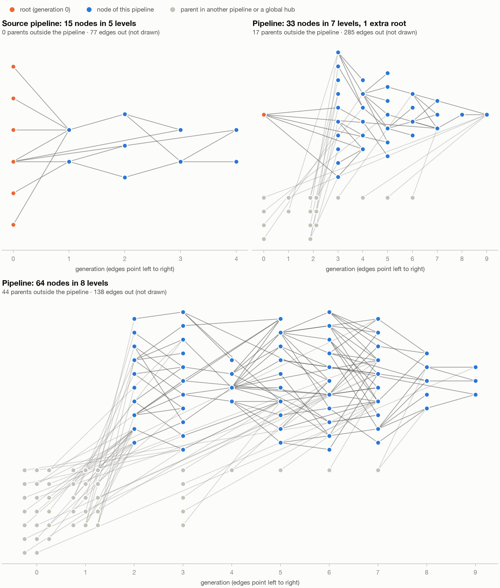
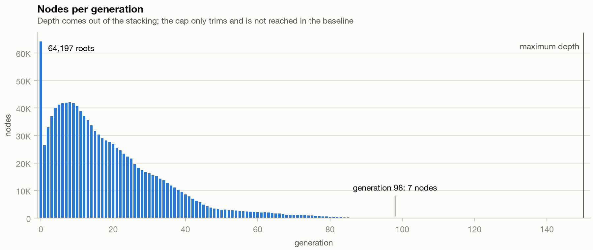
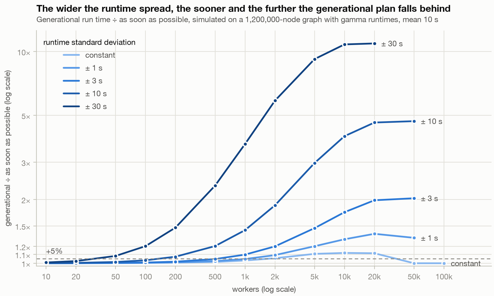
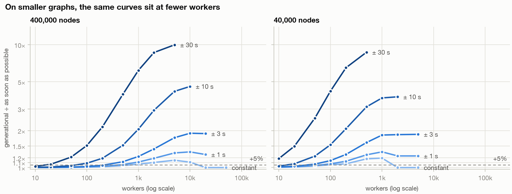

# Performance experiments for DAG workflows

Performance experiments following a discussion on whether to compile an execution plan with a
generational topological sort, or to evaluate the DAG representation at runtime, specifically for
large flows of 500k to 5M nodes.

This is split into a few parts:

1. Generating synthetic graphs that simulate the shapes of actual data pipeline DAGs.
2. Using the synthetic graphs, evaluating the memory and computational complexity of runtime DAG
   evaluation against compiling an execution plan.
3. A solution for coordinating runtime DAG evaluation in a distributed system of workers, with
   MongoDB as the central data store.

# Takeaways

- Graph computation time is negligible, even for millions of nodes: In plain Python, compiling
  the plan of the 1.2M-node graph takes 1.5 s, and popping completed nodes (the runtime cost of
  running as soon as possible) 2 s, against 16 minutes for the fastest possible run of that graph
  with every node taking only 10 s. At 5M nodes, both take about 10 s.
- Runtime coordination has a cost, but scales well: A basic setup coordinating the graph state in
  MongoDB handles about 5,000 completions a second, four times what the 1.2M-node graph needs at
  its peak. A run with 10,000 workers took 0.5% longer than the simulation, where coordinating
  costs nothing.
- Which approach wins depends on the number of workers and on how much runtimes vary: With
  up to 500 workers and runtimes within ±3 s of a 10 s mean, the generational plan stays within
  about 5% of running nodes as soon as possible. The wider the spread, the sooner it falls
  behind: at ±30 s it ends up 11× slower.

# Generating synthetic graphs representing actual data pipeline DAGs

The experiments run on synthetic graphs shaped like data-flow dependency graphs (ETL, lineage,
build-style task execution). A graph is made of thousands of pipelines of different sizes, each
internally layered, and most consume outputs of earlier pipelines. A few heavily shared nodes act
as global hubs. The graph generation logic is built to make graphs that look like real flows, so
the results of the performance experiments reflect what you'd see with large data-flow DAGs.

A node's generation is its longest path from a root: the batch a generational sort puts it in. In
the baseline graph of 1.2M nodes and 2.9M edges:

- **Many small pipelines, a few large ones**: half of the 4,000 pipelines have fewer than 150
  nodes, and the largest have 5,000.
- **Many inputs**: generation 0 is the widest, with 5.5% of the nodes. Most are raw tables at the
  start of a source pipeline, read by a few transformations.
- **Wide early, with a long thin tail**: pipelines build on the outputs of earlier ones, so 87% of
  the nodes sit in the first 40 of 94 generations.
- **Mostly local edges**: 83% of the edges stay inside a pipeline, and two thirds go to the
  previous generation.
- **Few dependencies, a long tail of dependents**: 82% of the nodes with dependencies have one to
  three, while the top hubs (simulating dimension tables, calendars, config) have up to about
  3,400 dependents.
- **Sinks are outputs**: the 17% of nodes that nothing reads are pipeline outputs and side outputs
  such as reports and exports.





The model, its parameters and why, and the full statistics are in
[docs/synthetic_graphs.md](docs/synthetic_graphs.md).

# Compiling a plan or evaluating at runtime

The two ways to run a DAG, both in plain Python in `src/dag_experiments/evaluation/`:

- **Compiled generational plan**: before the run, Kahn's algorithm sorts the nodes into
  generations. Workers then run the plan generation by generation: a generation starts once the
  previous one has finished.
- **As soon as possible**: before the run, the graph is converted into a representation that is
  easy to use at runtime, a dict holding every node's dependents and its unfinished
  dependencies. When a node completes, it is popped from its dependents' dependencies, and a
  dependent whose last dependency was popped can run right away.

## Preparing the graph

Both take time and memory linear in the nodes plus edges, O(V + E): compiling the plan visits
every edge once, and so does building the dict. Measured on an Apple M5 Pro with 24 GB, Python
3.13. The peak is memory on top of the input edge list; what is kept is what the result holds
once that list is gone, including the node ids it shares with it.

| Nodes | Compile the plan | Peak while compiling | Plan kept | Build the dict | Dict kept | Pop completed nodes, whole run |
|-------|------------------|----------------------|-----------|----------------|-----------|--------------------------------|
| 10k   | < 0.01 s         | 1 MB                 | 1 MB      | < 0.01 s       | 6 MB      | < 0.01 s                       |
| 100k  | 0.06 s           | 12 MB                | 4 MB      | 0.10 s         | 64 MB     | 0.11 s                         |
| 1.2M  | 1.5 s            | 142 MB               | 49 MB     | 2.0 s          | 769 MB    | 2.0 s                          |
| 5M    | 8.5 s            | 594 MB               | 203 MB    | 10.0 s         | 3,250 MB  | 10.3 s                         |

- **Both take seconds to prepare**, in practice growing a little faster than the node count:
  8.5 s for the plan and 10 s for the dict at 5M nodes.
- **Memory is where they differ.** The plan needs its working memory only while compiling; the
  workers then need only the batches, about 40 bytes per node: 49 MB at 1.2M nodes. The dict has
  to stay in memory for the whole run, about 650 bytes per node: 769 MB at 1.2M nodes and 3.3 GB
  at 5M.
- **Evaluating at runtime does the plan's work during the run.** Popping every completed node
  from the dict takes about as long as compiling the plan, around 2 µs per node. A single process
  could keep up with about 500,000 completions a second this way, far more than the at most 1,300
  a second of the simulated runs below.

## Running the graph

A simulation runs the 1.2M-node baseline graph with a fixed number of workers. Every node gets a
runtime from a gamma distribution with a mean of 10 s, and the chart varies its standard
deviation: from 0, where every node takes exactly 10 s, to ±30 s, where 64% of the nodes take
under a second and 5% over a minute. Both approaches get the same runtimes. A worker runs one
node at a time, and handing out work costs nothing. Within a generation, each node goes to the
first free worker; as soon as possible hands ready nodes to free workers in the order they became
ready. The worker counts go 10, 20, 50, ... and stop at the first one where as soon as possible
is within 1% of its run time with a worker for every node.



> [!NOTE]
> The worker counts are large because the graph is: the point where the plan starts to fall behind
> grows with the graph. That is also why the chart shows a ratio rather than absolute run times.
> On smaller graphs the curves keep their shape at fewer workers.



- **With few workers, the plan costs little.** The workers are the bottleneck: 10 workers take
  about 333 hours either way. The plan stays within about 5% of as soon as possible up to 500
  workers for spreads up to ±3 s, up to 100 workers at ±10 s, and up to 20 workers at ±30 s.
- **The wider the spread, the sooner and the further the plan falls behind.** Each generation
  waits for its slowest node, and a wider spread makes that node slower compared with the
  others. At ±30 s the plan is 8% behind with 50 workers and ends up 11× slower: 12 hours,
  against 67 minutes for the longest path through the graph.
- **Even with no spread, limited workers cost the plan up to 12%.** Between 2,000 and 20,000
  workers, the narrow generations late in the graph leave part of the pool idle, while as soon as
  possible fills it with work from later generations. With a worker for every node, both take the
  same 16 minutes: each of the 94 generations adds exactly 10 s.

> [!NOTE]
> The simulation leaves out a cost that running as soon as possible adds: coordinating the
> workers through the shared dict, which the next section covers.

# Coordinating runtime DAG evaluation across distributed workers

Evaluating at runtime needs the dependency dict for the whole run. To share it between workers
on many machines, the solution below moves it into a MongoDB collection: a document per node,
with its dependents and the dependencies that have not completed yet. There is no scheduler.
Instead, each worker:

1. claims a ready node
2. runs it
3. on completion, in one MongoDB call that is atomic for each dependent:
   1. removes the node from the dependencies of all of its dependents
   2. sets each dependent left without dependencies to ready
4. marks the node done

The code is in `src/dag_experiments/distributed/`.

```js
{
  _id: 4711,
  state: "waiting",          // waiting, then ready, running and done
  dependencies: [12, 980],   // the ones not completed yet
  dependents: [5120, 77031],
  runtime: 0.4,              // what the worker simulates; a real DAG would hold the task
  random_key: 0.7316,        // where claims look for a ready node

  // Set once a worker claims it: worker and started_at; finished_at once it's done.
}
```

## The MongoDB calls

1. A worker picks a random ready node and claims it. Every node gets a random key at load,
   and an index on `{state: 1, random_key: 1}` finds the first ready node at or after a random
   key, or else the last one before it. `findOneAndUpdate` then checks and changes that
   document in one atomic step, so of the workers that picked the same node, one gets it. The
   others find it no longer ready and pick another, for at most three picks per claim.

   ```js
   const key = Math.random()
   const [pick] = db.nodes.find({ state: "ready", random_key: { $gte: key } }, { _id: 1 })
     .sort({ random_key: 1 }).limit(1).toArray()  // if none: $lt the key, sorted the other way
   db.nodes.findOneAndUpdate(
     { _id: pick._id, state: "ready" },
     [{ $set: { state: "running", worker: "host-pid-thread", started_at: "$$NOW" } }],
     { projection: { runtime: 1, dependents: 1 } }
   )
   ```

> [!NOTE]
> ### Why that random key?
> The random key spreads the claims over the ready nodes. Without it, a claim would be one
> `findOneAndUpdate({ state: "ready" }, …)` that leaves the choice to MongoDB, and every claim
> would choose the same node, because they all run the same query down the same index.
>
> MongoDB lets only one of them change the document, but it doesn't let the others skip to a
> different document, as `SELECT … FOR UPDATE SKIP LOCKED` does in PostgreSQL. The others get a
> write conflict and run again, and each lands on the next ready node, together with every
> other claim that lost.
>
> With that random key, each worker randomly chooses a ready node, so claims rarely collide. On
> Google Cloud with 10,000 workers, that came to 0.2 write conflicts per node, against 12 when
> claiming the oldest ready node. In the simulation, handing out ready nodes in random order
> changes the run time by less than 0.5%.

2. Once the node has run, the worker pulls it from its dependents' dependencies, in one call
   for all of them, and a dependent left without dependencies becomes ready in the same update.

   ```js
   db.nodes.updateMany(
     { _id: { $in: [5120, 77031] }, dependencies: 4711 },
     [
       { $set: { dependencies: { $setDifference: ["$dependencies", [4711]] } } },
       { $set: { state: { $cond: [{ $eq: ["$dependencies", []] }, "ready", "waiting"] } } }
     ]
   )
   ```

> [!NOTE]
> You could also drop the ready state and count a node as ready once its list of dependencies
> is empty. But running and done nodes have empty lists too, so a claim would still need a state
> to tell them apart, and an index on `dependencies` would be much larger: an entry for every
> dependency not completed yet, instead of one per node.

3. Then it marks the node done.

   ```js
   db.nodes.updateOne({ _id: 4711, state: { $ne: "done" } }, [{ $set: { state: "done", finished_at: "$$NOW" } }])
   ```

4. When no node is ready, the worker checks whether any node is left to run. Then it waits,
   10 ms at first and doubling up to 1 s, and tries to claim again. With more than 10 workers
   each one waits longer, so that the idle ones together ask about 1,000 times a second at most:
   with 10,000 workers, every idle one asks once every 10 s.

   ```js
   db.nodes.findOne({ state: { $ne: "done" } }, { _id: 1 })
   ```

> [!NOTE]
> The calls above are a slight simplification of the code, which also has a lease system in
> case workers die. Without it, a worker dying during a run would leave its node running
> forever, and the run would never finish:
>
> - A claim also sets `lease_until` a minute ahead on the server's clock.
> - While the node runs, a background thread pushes it back every 20 s.
> - Idle workers, once a minute each, set the running nodes whose lease ran out back to ready,
>   through an index on `lease_until`. Another worker then takes over a node whose worker died,
>   or whose claim reply got lost.
>
> That is also why the dependents are released before the node is marked done. A worker that
> dies in between leaves the node running, and the one taking it over repeats the release.

Three more choices keep the calls safe with many workers sharing them over a network:

- **Every call is safe to repeat**, so a worker retries a call that fails on the network
  instead of giving up on its node.
- **Dependencies are a list to pull from, not a count.** A count lowered with `$inc` would be
  smaller, but repeating the release would lower it twice and release a dependent too early.
  Pulling a dependency that is already gone leaves the list as it is, and the
  `dependencies: 4711` filter skips those dependents altogether, so a repeated release can't set
  a running or done dependent back to ready.
- **Each call changes documents atomically one by one**, so there are no transactions, and a
  single MongoDB server is enough.

## In a fully local setup

Docker compose runs MongoDB and the worker containers on one machine; the commands are under
[Distributed workers](#distributed-workers). A worker simulates a node by sleeping for its
runtime. Measured with MongoDB 8.2 on Linux, on 10 cores of an AMD Ryzen 7 H 255 with 24 GB that
MongoDB and the workers share.

MongoDB has to keep up with the rate at which nodes complete, at four calls per node. In the
simulation of the baseline graph, a mean runtime of 10 s gives at most 1,300 completions a
second. The local runs reach the same rate with 100 times fewer workers by making the runtimes
100 times shorter: a mean of 0.1 s with a standard deviation of 0.3 s, the ±30 s spread of the
chart scaled down. The report runs the simulation on the same graph, runtimes and number of
workers, where coordinating costs nothing.

| Nodes | Workers | Run     | Simulation | Behind | Completions/s | MongoDB calls per node |
|-------|---------|---------|------------|--------|---------------|------------------------|
| 100k  | 100     | 106.2 s | 104.4 s    | 2%     | 940           | 1.4 ms                 |
| 1.2M  | 130     | 950.4 s | 933.5 s    | 2%     | 1,260         | 1.4 ms                 |

To find the most MongoDB can take, nodes with no runtime have the workers claim and complete
nodes nonstop, on a 50k-node graph:

| Workers                    | Completions/s |
|----------------------------|---------------|
| 1                          | 940           |
| 10, in separate containers | 5,180         |
| 50, as 10 containers of 5  | 4,670         |

- **At the baseline graph's peak rate, coordinating costs about 2%.** The MongoDB calls take
  about 1.4 ms per node: 1.4% of the scaled-down 0.1 s mean runtime, and 0.014% of the real
  10 s. Loading the 1.2M-node graph takes 13 to 15 s and 163 MB of documents.
- **One MongoDB handles about 5,000 completions a second**, four times the baseline graph's
  peak, using 4.5 of the 10 cores.
- **A crashed worker costs one lease.** With a lease of 5 s, killing one of four containers of
  5 workers each mid-run left its 5 running nodes to the other 15 workers once the leases ran
  out, and they finished all 20,000 nodes.

> [!NOTE]
> The local runs leave out thousands of workers, and with them the network between workers and
> MongoDB. The next section runs 10,000.

## Deployed as a Google Cloud Run project

The same image runs on Google Cloud, in europe-west1: MongoDB 8.2 in a container on a
c3-standard-8 VM (8 vCPU, 32 GB), and the workers as a Cloud Run job of 50 tasks with 1 vCPU
and 1 GiB, each running 200 workers: 10,000 in all. The tasks reach MongoDB over the VPC, and
wait for each other before they start, so the run starts with every worker, as the simulation
does. A monitor samples MongoDB's CPU, calls and connections every 10 s; the commands are under
[Distributed workers](#distributed-workers).

The graph is the 1.2M-node baseline with its real runtimes: a mean of 10 s, with a standard
deviation of 30 s. With that spread, 70% of the workers wait at any time on average, which makes
the idle workers the main load on MongoDB.

| Run     | Simulation | Behind | Claim | Complete | MongoDB cores, mean and peak | Calls a second, mean | Write conflicts per node |
|---------|------------|--------|-------|----------|------------------------------|----------------------|--------------------------|
| 4,063 s | 4,041 s    | 0.5%   | 22 ms | 24 ms    | 1.2 and 7.6                  | 4,000                | 0.2                      |

- **The run took 0.5% longer than the simulation, 21 s.** Random claim order alone moves the run
  time about that much. A node that becomes ready also waits for an idle worker to ask, and
  each of the 10,000 asks every 10 s, so the fewer are idle, the longer that wait.
- **MongoDB stays well within the VM.** It ran at 0.7 to 1.7 cores, with 3,300 calls a second
  in the tail. The peak of 7.6 cores lasts only the first 20 seconds, when all 10,000 workers
  claim at once.
- **Connections stay at about 7,000**, one per worker thread busy at the start, because the
  driver keeps the connections it opened. At 1 MB or so each, they fit the VM's 32 GB.
- **A task's 200 workers share one vCPU.** At the real runtimes they complete about 20 nodes a
  second, which one vCPU keeps up with. In a smoke test with runtimes of 0.1 s, 100 workers in a
  single task ran 60% behind the simulation, against 4% as 10 tasks of 10 workers. Over the
  network a call takes about 0.6 ms longer than locally.

The run cost about $5 at list prices, before Cloud Run's free tier: $4.12 for 57 task-hours of
workers, $0.56 for the VM, $0.22 for loading, monitoring and reporting, and about $0.10 for
network traffic. With the earlier versions of the code and the smoke tests, the experiment came
to about $17.

# Running the experiments yourself

Install [uv](https://docs.astral.sh/uv/), then from the repository root:

```shell
uv sync
uv run pytest
```

The tests of the distributed workers start a throwaway MongoDB container through
[testcontainers](https://testcontainers.com/), so they need Docker, and are skipped without it.
They never use a MongoDB that is already running.

## Synthetic graphs

```shell
# Generate one graph and print the statistics from docs/synthetic_graphs.md
uv run python -m dag_experiments.synthetic report
uv run python -m dag_experiments.synthetic report --nodes 5000000 --seed 1

# Generate 10k, 100k, 1.2M and 5M nodes to check scaling
uv run python -m dag_experiments.synthetic sweep
```

## Evaluation

```shell
# Time and memory of preparing a graph both ways, at 10k, 100k, 1.2M and 5M nodes
uv run python -m dag_experiments.evaluation compile

# Simulated run time against the number of workers on the baseline graph, with gamma runtimes
# of mean 10 s and standard deviation 3 s
uv run python -m dag_experiments.evaluation simulate

# The same with several standard deviations, as in the chart
uv run python -m dag_experiments.evaluation simulate --runtime-sd 0 1 3 10 30
```

## Visualizations

```shell
# Redraw the charts in docs/images from the baseline graph
uv run python -m dag_experiments.visualization.charts

# Redraw the runtime spread charts, for the baseline and two smaller graphs (runs the
# simulations, several minutes)
uv run python -m dag_experiments.visualization.evaluation
```

## Distributed workers

### On a development system: docker

```shell
# Start MongoDB, then build the worker image and load the 100k-node graph with runtimes 100× shorter
docker compose up -d mongo
docker compose run --rm worker load --nodes 100000 --runtime-mean 0.1 --runtime-sd 0.3

# Run 10 worker containers of 10 workers each, until every node is done
THREADS=10 docker compose up --scale worker=10 worker

# Compare the run with the simulation of the same graph, runtimes and number of workers
docker compose run --rm worker report

docker compose down
```

`LEASE=5` before `docker compose up` shortens the lease to 5 s; `docker kill
dag-experiments-worker-1` during a run then shows the other workers taking over its nodes.
`uv run python -m dag_experiments.distributed work --threads 10` runs workers outside docker,
against the MongoDB of `compose.yaml`, on `localhost:27117`.

### On a Google Cloud Run project

`deploy/gcp.sh` runs MongoDB in a container on a VM, and the workers, the loader, the monitor and
the report as Cloud Run jobs that reach it over the VPC. It works in the project `gcloud` is set
to, in europe-west1, and needs docker, `gcloud` logged in and billing enabled on the project.

> [!WARNING]
> Running it as shown below costs about $5, like the run above. Only run it if seeing it run for
> yourself is worth that, and run `deploy/gcp.sh down` afterwards: until then, the VM bills for
> up to 6 hours.

```shell
gcloud services enable run.googleapis.com compute.googleapis.com artifactregistry.googleapis.com

# MongoDB on a c3-standard-8 VM that deletes itself after 6 hours, the worker image and the jobs
deploy/gcp.sh up

# Load the baseline graph with the runtimes of the run above, run 50 tasks of 200 workers,
# 10,000 in all, and compare the run with the simulation
deploy/gcp.sh load --nodes 1200000 --runtime-mean 10 --runtime-sd 30
deploy/gcp.sh run 50 200
deploy/gcp.sh report

# Push the worker image again after changing the code
deploy/gcp.sh image

# Delete everything again
deploy/gcp.sh down
```
